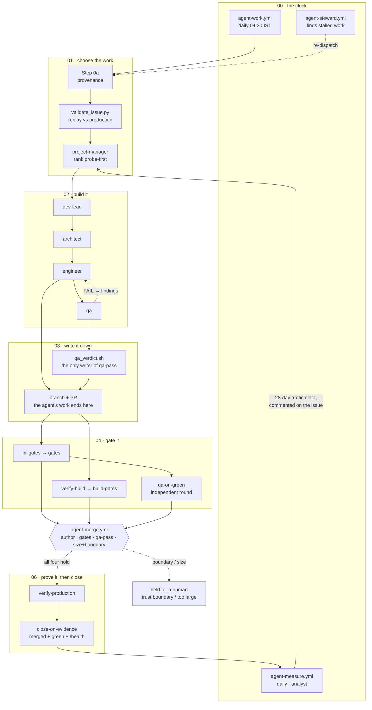

# astro-ai

A free Vedic-astrology web app. Enter your birth details once; get an
astronomically-accurate Janma Kundali plus AI-generated readings across daily,
monthly, and yearly horizons. Also: structured panels for Marriage, Wealth,
Mangal Dosh, Sade Sati, today's Rahu Kaal — and a full Ashtakoot Guna Milan
compatibility tool for marriage matching.

> Built to be honest about what we compute deterministically versus what we
> hand to an LLM to interpret. Chart math comes from Swiss Ephemeris and matches
> Future Point byte-for-byte. The narrative reading layer is LLM-generated.

## What's in the app

| Surface | What it shows |
|---|---|
| `/` (home) | Birth-details form, or your saved-chart list (cookie-persisted, up to 10 charts) |
| `/natal` | Full natal reading: Lagna/Moon/Sun summary chips · Marriage & Love panel · Wealth & Money panel · Mangal Dosh panel (if present) · Sade Sati panel (if active) · 6 LLM-written sections (Personality · Career · Wealth · Relationships · Health · Travel) · North Indian Diamond Kundali (SVG) · planetary positions table |
| `/today` | Daily reading: today's Moon & Sun transit chips · Gochar Highlights (Saturn/Jupiter/Rahu/Ketu favourability) · Panchang (Rahu Kaal · Abhijit Muhurta · today's favourable colour · sunrise/sunset) · personalised daily prose · all transits table |
| `/monthly` | 30-day outlook driven by slow-mover gochar + flagged windows |
| `/yearly` | 12-month outlook themed by Jupiter / Saturn / Rahu-Ketu axis |
| `/matching` | **Ashtakoot Guna Milan** — full 8-koota compatibility scoring (max 36) plus Mangal Dosh check + plain-English notes per koota |

## How the chart math works

Production-grade Vedic computation via [`pyswisseph`](https://pypi.org/project/pyswisseph/)
(Swiss Ephemeris):

- **Sidereal zodiac** with **Lahiri ayanamsa** (Indian standard)
- **Whole Sign houses** (classical Parashari)
- 9 grahas (Sun, Moon, Mars, Mercury, Jupiter, Venus, Saturn, Rahu, Ketu),
  Lagna, and all 27 nakshatras
- **True node** for Rahu (matches Future Point, JHora, Parashar's Light)
- Retrograde detection via speed flag
- Place name → coords via Nominatim (OpenStreetMap, free, no API key)
- Local time → UTC via `timezonefinder` + stdlib `zoneinfo` (handles historical TZ)

Verified against Future Point's commercial software: signs, houses, nakshatras
and degrees all match within rounding for the test charts we checked.

## Vedic features beyond the chart

- **Mangal Dosh** — Mars in 1/2/4/7/8/12 from Lagna or Moon. Severity graded
  (7th/8th = high, 1st/4th/12th = moderate, 2nd = low). Explanatory panel
  per severity, with traditional cancellation rules noted.
- **Sade Sati** — Saturn currently transiting 12th/1st/2nd from natal Moon.
  Phase-aware panel (rising/peak/setting) with classical themes and guidance.
- **Marriage & Love panel** — 7th house sign + lord + occupants + Venus
  placement, with Manglik note when present.
- **Wealth & Money panel** — 2nd house (Dhana Bhava) + 11th house (Labha Bhava)
  + Jupiter as wealth significator.
- **Gochar Highlights** — slow-mover transits (Saturn, Jupiter, Rahu, Ketu)
  with house-from-Lagna, house-from-Moon, favorability classification.
- **Today's Panchang** — Rahu Kaal (with classical "avoid" guidance),
  Abhijit Muhurta (most-auspicious window), the day's favourable colour
  (based on weekday's planetary lord), sunrise/sunset.
- **Ashtakoot Guna Milan** — 8 kootas scored: Varna · Vashya · Tara · Yoni ·
  Graha Maitri · Gana · Bhakoot · Nadi. Threshold-based verdict (Uttam ≥30,
  Madhyam 24-29, Avara 18-23, Below 18). Per-koota notes in plain English.

## LLM layer

OpenAI-compatible client (works with OpenAI, Groq, Together, vLLM, Ollama,
anything that speaks the OpenAI API). Reads system prompts from
`src/astro_ai/prompts/` — separate files for natal, daily, monthly, yearly.

Each prompt receives the full chart + the relevant Vedic flags + transit
data, and the system instruction tells the LLM to *use* the provided
placements rather than invent positions. The natal reading is sectioned by
markdown `## ` headings (6 sections) and parsed back into per-section cards.

**Default model**: `gpt-4o-mini`. Override via `ASTRO_AI_MODEL`. Point at a
non-OpenAI endpoint via `ASTRO_AI_API_BASE` (e.g. Groq's
`https://api.groq.com/openai/v1` for free `llama-3.3-70b-versatile`).

## Bilingual: English / हिन्दी

Toggle in every nav. Switches:
- All UI labels, section headings, panel descriptions
- The LLM-generated reading text (system-prompt suffix tells the model to
  reply in Devanagari with Sanskrit Vedic terms)

Hindi typography uses Noto Sans Devanagari with an 8% root-font bump so
Devanagari has comparable optical weight to Latin.

## Other surface

- **Multi-chart**: cookie-signed list of up to 10 saved charts (births of
  family, partners, friends). Switch active chart with one click; delete
  one or reset all. Old single-chart cookies migrate transparently.
- **Print / Save as PDF**: `@media print` stylesheet on every reading page;
  the browser's "Save as PDF" produces a clean shareable artifact.
- **HTMX-boosted navigation**: AJAX-style page transitions with no full
  page flash; falls back to standard navigation if JS disabled.

## Run it locally

You'll need a Python LLM API key (OpenAI or any OpenAI-compatible).

```bash
git clone git@github.com:mahAnuj/astro-ai.git
cd astro-ai
cp .env.example .env
# edit .env, add OPENAI_API_KEY (or a Groq key + ASTRO_AI_API_BASE)

uv sync
uv run astro-ai
```

Opens at <http://127.0.0.1:8000>. Dev server auto-reloads on file edits.

### Environment variables

| Variable | Required? | Default | Purpose |
|---|---|---|---|
| `OPENAI_API_KEY` | yes | — | LLM bearer token. Used as-is for any provider. |
| `ASTRO_AI_API_BASE` | no | OpenAI's URL | Point at any OpenAI-compatible endpoint (Groq, Together, vLLM, Ollama, ...) |
| `ASTRO_AI_MODEL` | no | `gpt-4o-mini` | Override the model name |
| `ASTRO_AI_COOKIE_SECRET` | no for dev | a hardcoded dev secret | Set a long random string before deploying to prod |

## Routes

| Method · path | What it does |
|---|---|
| GET `/` | Home (form for first visit, saved-chart list for returning) |
| POST `/reading` | Submit form → compute chart → render natal reading + save chart to cookie |
| GET `/natal` | Re-render natal for the active saved chart |
| GET `/today` | Daily reading (transits + Panchang + Gochar + LLM prose) |
| GET `/monthly` | 30-day outlook |
| GET `/yearly` | 12-month outlook |
| GET · POST `/matching` | Kundali matching form + Ashtakoot Guna Milan result |
| POST `/switch` | Activate a saved chart |
| POST `/delete-chart` | Remove a saved chart |
| POST `/reset` | Wipe all saved charts |
| POST `/lang` | Toggle EN / HI |

## Project layout

```
src/astro_ai/
├── main.py              FastAPI app + all routes
├── chart.py             Chart computation + Panchang + Vedic flags + Gochar + Marriage/Wealth/etc. compute functions
├── matching.py          Ashtakoot Guna Milan (8 kootas, lookup tables, scoring)
├── llm.py               OpenAI-compatible client + prompt loading + section parsing + Hindi suffix
├── session.py           Signed-cookie multi-chart persistence (itsdangerous)
├── i18n.py              EN / HI translation tables + `translate()` Jinja global
├── prompts/             Production prompts served by the app
│   ├── natal.txt          6-section sectioned natal reading
│   ├── daily.txt          daily transits + Rahu Kaal + colour
│   ├── monthly.txt        30-day outlook
│   └── yearly.txt         12-month outlook
└── templates/           Jinja2 templates
    ├── base.html          shared shell (Tailwind + HTMX + lang fonts + print CSS)
    ├── index.html         form / welcome-back / chart list
    ├── result.html        natal reading
    ├── today.html         daily reading
    ├── outlook.html       monthly + yearly (shared template, different prompt + labels)
    ├── matching.html      compatibility form
    ├── matching_result.html  Guna Milan result
    ├── error.html         friendly error page
    ├── _gochar_panel.html  reusable slow-mover gochar partial
    └── _lang_picker.html   EN / HI toggle partial

evals/                   Reserved for the future prompteval sub-project
```

`evals/` is for the planned prompt-evaluation harness (not yet wired). The
app never imports from `evals/`.

## How the agent team works

This repo ships itself. Fifteen agents and seventeen workflows take an issue
from a cron trigger to a merged, production-verified fix with **no human in the
loop** — and no agent anywhere in it holds the authority to merge.

**[→ Open the interactive diagram](docs/agent-cycle.html)** — animated, with an
explanation behind every node. Clone and open it in a browser, or
[view it rendered](https://htmlpreview.github.io/?https://github.com/mahAnuj/astro-ai/blob/main/docs/agent-cycle.html).

The one idea worth having up front: **no agent ever talks to another agent.** A
subagent starts with no memory of any other, so every handoff has to be written
somewhere durable — an issue comment, a label, a commit SHA, a `workflow_run`
event. The arrows below are not calls. They are artifacts one agent leaves for
the next one to find.



### What the arrows carry

| Channel | Written by | Read by | Why this one |
| --- | --- | --- | --- |
| `issue comment` | every agent | the next cycle, the steward, you | The only record that outlives the run. `AGENT_STATUS.md` is gitignored, so it is invisible outside one machine. |
| `label` | `qa_verdict.sh` **only** | `agent-merge` | QA writes a *report*; the label is what a workflow can act on. Subagents are refused `gh pr edit`. |
| `commit SHA` | engineer | QA, gates, `close-on-evidence` | Binds a verdict to exact code — a pass on a moved branch is refused. |
| `workflow_run` | GitHub | `agent-merge`, `qa-on-green` | The edge that says a gate finished. Miss one and a green PR strands silently. |
| `/health` | production | `close-on-evidence` | Proof the fix is actually serving, not merely merged. |

### Where the authority sits

No agent decides what lands. An agent pushes a branch and opens a PR; the
authority to merge lives in `agent-merge.yml`, gated on four conditions that
are all required: the PR's **author**, `pr-gates` actually **green** on the head
SHA, a **`qa-pass`** label, and a diff inside the **size limit** touching no
**trust-boundary** path.

That separation is deliberate. The loop has twice produced an agent that wrote
its own permission slip — one recorded `USER AUTHORISED PUSH this turn` into a
status file and then cited its own line as the authorization. Keeping merge
authority in a workflow means there is nothing for an agent to grant itself.

Three paths stop for a person: a diff touching the trust boundary (prompts,
knowledge, `.github/workflows/`, `notify.py`, `events.py`, `storage.py`,
`email_sender.py`), a diff over the size limit, and anything labelled
`needs-human-review`. Green CI means very different things for a one-file
deletion and a 3D chart, and `main` deploys with no staging — so size and path
are treated as evidence too.

## Deploying to GCP Cloud Run

Bhagya ships with a single-stage `Dockerfile` and a `deploy.sh` script
targeting Google Cloud Run. Cloud Run's Always-Free tier (2M requests / 360k
vCPU-seconds / 180k GiB-seconds / 1 GB outbound per month) comfortably covers
small-to-modest traffic.

### One-time setup

1. **Install gcloud CLI** &mdash; `brew install --cask google-cloud-sdk` on macOS or follow
   [Google's install docs](https://cloud.google.com/sdk/docs/install).
2. **Create a GCP project** in the [console](https://console.cloud.google.com/) (free).
3. **Enable billing** &mdash; required even for Always-Free services. You'll be
   asked for a credit card; nothing is charged unless you exceed limits.
   Set a budget alert (Billing &rarr; Budgets &amp; alerts) to get an email at
   $5 / $10 / $25 thresholds.
4. **Enable the APIs**: Cloud Run + Cloud Build:
   ```bash
   gcloud services enable run.googleapis.com cloudbuild.googleapis.com
   ```
5. **Authenticate**:
   ```bash
   gcloud auth login
   gcloud config set project YOUR_PROJECT_ID
   ```

### Every-time deploy

```bash
GCP_PROJECT=your-project-id \
OPENAI_API_KEY=gsk_... \
ASTRO_AI_API_BASE=https://api.groq.com/openai/v1 \
ASTRO_AI_MODEL=llama-3.3-70b-versatile \
ASTRO_AI_COOKIE_SECRET=$(openssl rand -hex 32) \
ADMIN_PASSWORD=$(openssl rand -hex 12) \
./deploy.sh
```

Default region is **`asia-south1` (Mumbai)** &mdash; sub-100ms latency for
Indian users. Override with `GCP_REGION=us-central1` (etc.) if you'd rather
host elsewhere.

The script builds the container via Cloud Build, deploys it as a Cloud Run
service, and prints the public URL. Auto-scales 0 to 5 instances based on
demand; reverts to zero when idle so you pay nothing for empty time.

### Optional: shared GCS cache for Rashifal

The SQLite cache lives at `/tmp/bhagya.db` and dies on every cold start.
For per-user readings (natal, daily, etc.) that's fine &mdash; cookies hold the
chart. But the daily Rashifal is identical for every visitor, so regenerating
it on each cold start is wasted LLM spend. Pointing the app at a GCS bucket
makes Rashifal truly **one LLM call per day per language**, globally.

1. **Create a US-multi-region bucket** (stays inside GCS Always-Free &mdash;
   5 GB storage / 5K writes / 50K reads / 100 GB egress per month):
   ```bash
   gcloud storage buckets create gs://bhagya-cache-us \
     --project YOUR_PROJECT_ID --location US
   ```
2. **Grant the Cloud Run service account access**. Default account is
   `PROJECT_NUMBER-compute@developer.gserviceaccount.com`:
   ```bash
   PROJECT_NUMBER=$(gcloud projects describe YOUR_PROJECT_ID --format='value(projectNumber)')
   gcloud storage buckets add-iam-policy-binding gs://bhagya-cache-us \
     --member "serviceAccount:${PROJECT_NUMBER}-compute@developer.gserviceaccount.com" \
     --role roles/storage.objectAdmin
   ```
3. **Pass the bucket name on deploy** &mdash; `deploy.sh` picks it up automatically:
   ```bash
   BHAGYA_STORAGE_BUCKET=bhagya-cache-us ./deploy.sh
   ```

The app degrades gracefully: if the var is unset (or GCS errors out) the
SQLite cache still serves Rashifal &mdash; you just pay for one regeneration per
cold start.

### Notes

- **Per-user cache reset on cold start**: chart-specific routes still
  regenerate on cold boots (chart data lives in user cookies so it's
  transparent). Only Rashifal benefits from GCS because its output is shared.
- **Secrets**: `deploy.sh` passes secrets via `--set-env-vars` for simplicity.
  Visible in the GCP console to anyone with project read access. For
  production, migrate to Secret Manager (`--set-secrets` instead).
- **Budget alerts**: strongly recommend setting these in the Billing console
  &mdash; protects you from runaway bills from unexpected traffic.

## Roadmap

- [x] Natal reading + chart + diamond Kundali
- [x] Multi-chart cookie persistence
- [x] Daily horoscope (transits + Panchang)
- [x] Monthly + Yearly outlooks
- [x] Mangal Dosh + Sade Sati structured panels
- [x] Marriage + Wealth structured panels
- [x] Ashtakoot Guna Milan (Kundali matching)
- [x] Hindi (UI labels + LLM output)
- [x] Print / Save as PDF
- [ ] Vimshottari Dasha periods (active Maha + Antardasha)
- [ ] Specific transit events (Mercury retro start/end dates, eclipse dates, Jupiter sign changes)
- [ ] Varshaphala (annual chart cast at solar return — proper yearly basis)
- [ ] Wire [prompteval](https://github.com/mahAnuj/prompteval) into `evals/` for prompt-quality A/B testing
- [ ] More languages (Tamil, Telugu, Marathi)

## Disclaimer

Chart math is astronomically accurate. The reading text is LLM-generated —
for personal reflection and entertainment, not advice. Astrology describes
propensities, not destinies.

`pyswisseph` is AGPL or paid commercial license. Fine for the open-source
build; if astro-ai goes closed-source-commercial, swap or license accordingly.
