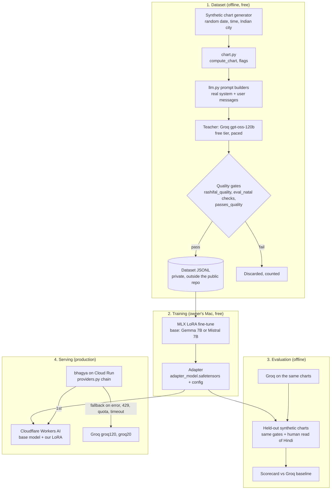

# Design: a fine-tuned model of our own, replacing Groq as the first provider

Status: **proposal, for owner review.** Nothing here is built. No code, prompt,
workflow or deploy setting changes with this document.

Written 2026-11-03 against `main` at 612ac31.

## 1. Summary

Train a small open model on readings that already pass this repo's quality
gates, train it for free on the owner's Mac, serve it for free from Cloudflare
Workers AI, and put it **first** in the existing provider chain with Groq kept
as the fallback.

- **Training data is synthetic.** Random birth details, run through our own
  chart code and our own prompts, answered by Groq, kept only if they pass the
  gates. No user data, no Claude output.
- **Training is local.** LoRA fine-tuning with Apple's MLX on an M5 / 24 GB.
- **Serving is free, with limits.** Workers AI accepts our LoRA adapter on a
  small set of base models and gives 10,000 Neurons a day free.
- **Rollout is per route, behind the chain.** If our model fails, is out of
  quota, or is slower than a deadline, the request falls through to Groq
  exactly as a 429 does today.

The decision asked of the owner is in [section 12](#12-decisions-for-the-owner).

## 2. Why

What the current setup costs us, from this repo's own records:

- **Rule-following.** Across 252 published rashifal readings over 21 days the
  Groq path named a planet the prompt forbids in **31.0%** of them
  (`src/astro_ai/rashifal_quality.py`, #513). A prompt rule is a request; a
  fine-tuned model has the rule in its weights.
- **Prompt size against a free tier.** `prompts/natal.txt` had to be cut from
  18,095 B to about 13 KB to get under a Groq 413 ("Limit 8000, Requested
  8562"), and every prompt change has to pass `scripts/verify_token_budget.py`.
  A model trained on the rules needs the chart data, not 13 KB of instructions.
- **One vendor's free tier is the ceiling.** 8,000 TPM per model and a
  200,000 TPD limit on the rashifal path (`.claude/agents/engineer.md`); the
  chain is `groq120,groq20`, with `openai` at the end as a paid safety net.

What it would give the business: a measured, honest case study — "a small model
trained on our gates beat the cloud model on our own rule checks, at zero cost"
— which is a service the owner wants to sell.

## 3. Goals and non-goals

Goals

1. A model that breaks the hard output rules (headings, planet/sign/house
   leaks, jargon, banned openings) **less often than Groq does today**, measured
   by the existing checks.
2. Zero recurring cost.
3. No change in availability: Groq remains a fallback on every route.
4. No personal data in any dataset, ever.

Non-goals

- Replacing the nightly Claude rashifal job (`rashifal-generate.yml`). It stays.
- Serving from the owner's laptop. A laptop is not production.
- Removing Groq. It is demoted, not deleted.
- Matching Claude's quality. The bar is "better than Groq on our gates".

## 4. Constraints that shaped the design

| Constraint | Source | Consequence |
| --- | --- | --- |
| No paid services | Owner, 2026-11-03 | Free hosting only; see section 9 for what that rules out |
| **Claude outputs cannot be training data** | Anthropic Usage Policy: no using "outputs to train an AI model (e.g., 'model scraping' or 'model distillation') without prior authorization"; Consumer Terms §3 | The nightly Claude rashifal readings are excluded from every dataset |
| **User data cannot be training data** | `templates/privacy.html`: Ask answers are "Never used to train any AI model"; vendors are not "permitted to use your data to train models"; birth details are collected to "compute your Vedic birth chart" | No live readings, Ask questions or matching partners; synthetic charts only. Also a DPDP purpose question if ever reconsidered |
| Groq outputs are usable | Groq Services Agreement §6.3(e) restricts only building a competing cloud service; the teacher models (`openai/gpt-oss-120b`, `gpt-oss-20b`) are Apache 2.0 open weights | Groq is the teacher |
| The serving host limits the base model | Workers AI LoRA: base must be one of its `-lora` models, adapter rank ≤ 8 (up to 32 accepted), file < 300 MB, `model_type` mistral/gemma/llama | Base model choice is decided by serving, not by which small model is best today |
| Production is live and deploys on merge | `CLAUDE.md`; Cloud Build trigger on `main`; no staging | All work before phase 4 happens outside `src/`; phase 4 goes through the normal agent loop and gates |

## 5. Architecture

### 5.1 Synthetic chart generator

A script that produces birth details nobody has: a uniformly random date over
a realistic span (say 1950–2010), a random minute of the day, and a city drawn
from a fixed list of Indian cities with coordinates. It is a scaled-up version
of what `evals/generate_dataset.py` already does for five fixtures, and like
that script it calls the app's own `compute_chart`, `compute_vedic_flags` and
formatters, so the model sees exactly the user message production would send.

**Stratify, don't just sample.** Random dates under-represent rare cases. The
generator should fill quotas per Lagna, per Moon sign, Manglik yes/no, Sade
Sati yes/no and dasha lord, so each appears often enough to learn.

Names: a fixed neutral placeholder, or none, so the model never learns to
echo a real-looking name.

### 5.2 Teacher generation

Each synthetic chart is sent to Groq through the app's own builders, per
route: natal, matching (two synthetic people), outlooks (daily, monthly,
yearly), and Ask with a fixed bank of question **types** written by us
(career timing, marriage, health caution, money) — never real questions.

Budget: the free tier is about 200,000 tokens a day on the model in question.
At a few thousand tokens per natal reading that is roughly 50–100 readings a
day, so a dataset of a few thousand examples takes **weeks**. That is
acceptable; it costs nothing. The job must:

- pace itself with the same token-bucket logic the app uses, so it never
  starves production of quota (run it in a different time window from the
  app's peaks, or on a separate free key the owner creates);
- record the exact prompt version (file hash) with every row, so a prompt
  change does not silently mix two targets into one dataset.

### 5.3 Quality gates as the filter

The dataset contains only teacher outputs that pass the checks this repo
already trusts:

- `src/astro_ai/rashifal_quality.py` style rules (rashifal);
- the mechanical checks in `scripts/eval_natal_prompt.py`: exactly the seven
  `## ` sections in order, no planet, sign or house names, no jargon;
- `providers.passes_quality` minimum length and heading counts per route;
- the safety rules in the prompts that are checkable as text (for example no
  prediction of death or terminal illness).

This is the main reason the student can beat the teacher: **it only ever sees
the teacher's compliant answers.** The discard rate is itself a useful number
to publish.

### 5.4 Dataset storage

JSONL rows of `{route, prompt_version, messages, completion, checks}`. The
repository is public, so the dataset does **not** go in it. Options, owner's
choice: a private folder in the existing GCS bucket, a private Hugging Face
dataset, or the Mac only with a backup. It contains no personal data, so the
choice is about size and convenience, not privacy.

### 5.5 Training

[MLX-LM](https://github.com/ml-explore/mlx-lm) LoRA fine-tuning on the M5 with
24 GB. A 7B base needs 4-bit quantised weights (QLoRA) to train comfortably in
that memory. Settings that matter for serving:

- LoRA rank ≤ 8 (Workers AI also accepts up to 32);
- adapter exported as `adapter_model.safetensors` and `adapter_config.json`,
  under 300 MB;
- **to verify in phase 2:** Workers AI applies adapters to a non-quantised base.
  An adapter trained against a 4-bit base usually transfers, but quality has
  to be re-measured on the served model, not just on the Mac.

One adapter per route family is simpler to evaluate than one adapter for
everything; Workers AI allows up to 100 adapters per account.

### 5.6 Evaluation

A held-out set of synthetic charts the model never saw, run through both our
model (as served by Workers AI, not only locally) and Groq, scored by the same
gates. The scorecard:

| Metric | Bar to ship a route |
| --- | --- |
| Planet / sign / house leak rate | Lower than Groq on the same charts |
| Heading structure correct | ≥ Groq |
| Jargon and banned-opening rate | ≤ Groq |
| Safety-rule violations | Zero on the held-out set |
| p95 latency (served) | Under the route's existing deadline |
| Hindi | Owner reads a sample of 20 and approves; English can ship without Hindi |

### 5.7 Serving

`providers.py` already treats every provider as an OpenAI-compatible endpoint
with its own `api_base`, key and model, in an ordered chain with fallback on
any error. Workers AI exposes an OpenAI-compatible endpoint, so the change is a
new chain entry (for example `workersai`) placed first: 
`BHAGYA_LLM_PROVIDERS=workersai,groq120,groq20`.

**To verify in phase 3:** whether Workers AI's OpenAI-compatible endpoint can
select a LoRA adapter, or whether the native `/ai/run` API (which takes a
`lora` parameter) is needed. If the latter, the new entry needs a small adapter
of its own rather than plain configuration.

Secrets: the Cloudflare API token goes in Secret Manager, mounted into the
service, never into code or a plain env var.

### 5.8 Rollout

Route by route, lowest stakes first: outlooks and matching, then Ask, natal
last. If the chain cannot yet be configured per route, adding that is part of
phase 4. Each route ships only after its scorecard passes, and the existing
runtime measurement in `llm._generate_rashifal_single` style is extended to
log which provider served each reading, so the leak rate can be watched in
production per provider.

## 6. Cost

| Item | Cost |
| --- | --- |
| Teacher generation | Groq free tier (time, not money) |
| Training | Owner's Mac (electricity) |
| Serving | Workers AI free allocation: 10,000 Neurons a day. By Cloudflare's listed rate for plain Mistral 7B (10,000 input / 17,300 output Neurons per million tokens), a reading with about 1,000 input and 1,500 output tokens is about 36 Neurons, so very roughly **250 readings a day** free. LoRA models are not priced separately on the pricing page: measure in phase 3 |
| Overage | None by default: past the daily allocation the chain falls through to Groq. Workers Paid would bill $0.011 per 1,000 Neurons; do not enable it |
| Dataset storage | Within existing free storage |

## 7. Risks

| Risk | Likelihood | Mitigation |
| --- | --- | --- |
| Workers AI LoRA support changes or stops being free ("free during this period" of the open beta) | Medium | Groq stays in the chain; the adapter also runs locally with MLX, so the work is not lost |
| Base models on offer are 2024-era (Gemma 2B/7B, Mistral 7B v0.2, Llama 2 7B) and weaker than current small models | High | The bar is our gates vs Groq, not general quality; re-evaluate if Cloudflare adds newer LoRA bases |
| Hindi quality from a 7B base | High | Ship English first; Hindi only with owner approval of samples |
| Teacher errors the gates cannot see (a wrong classical claim that breaks no format rule) are learned | Medium | Spot-check by the existing kundali-qa skill on a sample of the dataset; the student is no worse than the teacher on these, and the gates make it better on the rest |
| Generation job starves production of Groq quota | Medium | Separate key or off-peak window; the job stops at a fixed daily token cap |
| Latency over a route's deadline | Medium | Deadline-based fall-through to Groq, same mechanism as #475 |
| Model drifts from prompt changes | Medium | Every row carries a prompt hash; a prompt change means a re-generation and re-train before that route's adapter is trusted again |

## 8. Privacy and licensing, in one place

- **No user data.** Synthetic charts only. Nothing in the privacy policy needs
  to change for this design. If real data were ever wanted, it would need an
  opt-in, a policy update naming the new purpose, de-identification and
  withdrawal, and Ask questions and matching partners would still be excluded.
- **No Claude outputs.** The nightly Claude readings stay on the site and out
  of the dataset. Claude Code may still write the scripts, which is ordinary
  software work, but its readings are never training rows.
- **Teacher licence.** gpt-oss is Apache 2.0; Groq's agreement does not bar
  training on outputs for a non-competing product.
- This section is a reading of the published terms on 2026-11-03, not legal
  advice. Links in [section 13](#13-references).

## 9. Alternatives considered

| Option | Why not (now) |
| --- | --- |
| Train on live readings | Breaks the published privacy policy; DPDP purpose limitation; third-party data in matching |
| Train on the nightly Claude readings | Anthropic Usage Policy prohibits distillation without authorisation |
| Oracle Cloud Always Free (Arm, 2 OCPU / 12 GB) | CPU only: minutes per natal reading. Fine for a batch job, too slow for live routes. Idle instances can be reclaimed |
| Hugging Face Spaces | Docker/Gradio Spaces now need a paid plan; free accounts get two ZeroGPU Spaces with daily GPU quotas and sleep when idle |
| Cloud Run CPU next to the app | No GPU on the free tier; CPU inference would spend the app's own free tier |
| Serve from the owner's Mac | Production would depend on a laptop being awake |
| Paid hosts (Together, Fireworks, OpenAI fine-tuning, Hugging Face endpoints) | Excluded by the no-paid-services constraint |
| Keep prompting Groq, add more checks | Already happening (#513); this design builds on those checks rather than replacing them |

## 10. Phases

| Phase | What | Where | Done when |
| --- | --- | --- | --- |
| 0 | Owner approves this design and answers section 12 | — | Decisions recorded on the PR |
| 1 | Synthetic generator and teacher job; first 500 gated rows | Scripts outside `src/`, run locally or as a manual workflow | Dataset exists with discard rates per check |
| 2 | First LoRA on the Mac; offline scorecard vs Groq on held-out charts | Owner's Mac | Scorecard published in the PR |
| 3 | Upload adapter to Workers AI; measure served quality, latency and Neuron cost; confirm the LoRA API shape | Cloudflare (owner creates the account and token) | Served scorecard matches the local one |
| 4 | `workersai` provider in the chain, first route behind it, per-provider measurement | `src/`, through the normal agent loop, gates and QA | One route live with Groq fallback and a week of production numbers |
| 5 | Remaining routes, Hindi when approved | Same | Each route's bar met |

## 11. What would make us stop

- The phase-2 scorecard does not beat Groq on leak rate: stop, publish the
  negative result, keep Groq.
- Workers AI cannot serve a LoRA with acceptable latency or within the free
  allocation for our volume: keep the adapter for offline/batch use only.
- Any sign that a dataset row contains personal data: delete the dataset and
  fix the generator before continuing.

## 12. Decisions for the owner

1. Approve synthetic-only data (recommended) — or ask for an opt-in real-data
   path, which needs a privacy-policy change first.
2. Base model: Gemma 7B (better multilingual, recommended) or Mistral 7B.
3. Where the dataset lives: GCS private folder, private Hugging Face dataset,
   or the Mac only.
4. Separate free Groq key for generation, or share the production key off-peak.
5. First route to try: outlooks (recommended, lowest stakes) or rashifal
   fallback.
6. Create the Cloudflare account and API token (phase 3) — owner only.

## 13. References

- Cloudflare Workers AI, [LoRA adapters](https://developers.cloudflare.com/workers-ai/features/fine-tunes/loras/), [pricing](https://developers.cloudflare.com/workers-ai/platform/pricing/), [model catalog](https://developers.cloudflare.com/workers-ai/models/)
- [MLX-LM](https://github.com/ml-explore/mlx-lm) (LoRA and QLoRA on Apple silicon)
- Anthropic [Usage Policy](https://www.anthropic.com/legal/aup), [Consumer Terms](https://www.anthropic.com/legal/consumer-terms), [Commercial Terms](https://www.anthropic.com/legal/commercial-terms)
- Groq [Services Agreement](https://console.groq.com/docs/legal/services-agreement)
- [Oracle Cloud Always Free resources](https://docs.oracle.com/en-us/iaas/Content/FreeTier/freetier_topic-Always_Free_Resources.htm), [Hugging Face Spaces](https://huggingface.co/docs/hub/spaces-overview), [Cloud Run pricing](https://cloud.google.com/run/pricing)
- In this repo: `src/astro_ai/providers.py`, `src/astro_ai/rashifal_quality.py`, `scripts/eval_natal_prompt.py`, `scripts/publish_rashifal.py`, `evals/generate_dataset.py`, `.github/workflows/rashifal-generate.yml`, `templates/privacy.html`
